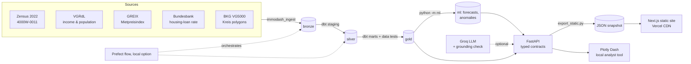

# ImmoDash: German rental market intelligence

**Live site: [immodash-virid.vercel.app](https://immodash-virid.vercel.app)** · rebuilt every Monday from open data ·
[How it works](https://immodash-virid.vercel.app/methodology) · [References](https://immodash-virid.vercel.app/methodology#references)

[](https://immodash-virid.vercel.app)

| District map | City profile | Affordability finder |
|---|---|---|
| [](https://immodash-virid.vercel.app/map) | [](https://immodash-virid.vercel.app/cities/berlin) | [](https://immodash-virid.vercel.app/affordability) |


A data platform and interactive dashboard for the German rental market. It brings together
**asking rents for 37 cities (monthly, 2012 to June 2026)**, **Zensus 2022 rents for all 400 Kreise**
(by rooms, by floor area, and on a **100 m grid** inside the cities), **vacancy**, **household income
and population**, and **housing-loan rates**. On top of that it computes an affordability index,
a supply-vs-demand index, **3/6/12-month rent forecasts** (LightGBM, calibrated intervals), **anomaly
flags**, and a **grounded AI market summary** per city.

Everything is built from open, official or academic sources. Nothing is scraped from listing portals
(see [ADR 0002](docs/adr/0002-open-data-instead-of-scraping.md)).



| Layer | Tooling |
|---|---|
| Ingestion | Python (`requests`, `pandas`, `openpyxl`), one parser per source, idempotent bronze loads |
| Warehouse | DuckDB locally, PostgreSQL in production. The same dbt project runs on both. |
| Transformations | dbt: bronze → silver (staging views) → gold (marts), plus 90 data tests (row values, volumes, relationships, and data recency in the weekly run) |
| Intelligence | LightGBM quantile regression + conformal calibration, robust-z anomaly detection, Groq LLM with a numeric grounding check |
| Geo | pyproj + shapely: 136k 1 km and 245k 100 m Zensus grid cells assigned to Kreise |
| Orchestration | Production: the weekly GitHub Actions job `refresh-site` (ingest with health checks, dbt, ML, quality gate, export, snapshot validation, site build, then a separate publish job). The Prefect flow `immodash-daily-refresh` is a local/self-hosted option only and does not publish the site |
| API | FastAPI with Pydantic response models (`/docs` for OpenAPI) |
| Frontend | Next.js 16 static export + Recharts + d3-geo, built from a JSON snapshot of the API: overview, city pages with 100 m canvas heatmaps, Kreis map, supply/demand, affordability finder, methodology |
| Dashboard | Plotly Dash analyst workbench, run locally only (the public product is the website, see ADR 0010): crossfiltering, choropleth, light/dark themes |
| Deployment | Free and always on: Vercel static hosting + weekly GitHub Actions refresh (`refresh-site.yml`); optional hosted API on Render/Railway. See `docs/DEPLOYMENT.md` |
| CI | GitHub Actions: ruff, dbt build on DuckDB **and** Postgres, pytest, end-to-end verification report, Next.js type-check and build |

## The public site (`web/`)

```bash
python scripts/export_static.py          # refresh web/public/data from the warehouse (via the API contracts)
cd web && npm install && npm run dev     # http://localhost:3000 ; `npm run build` writes the static site to web/out
```

| Page | What it shows |
|---|---|
| `/` | An editorial data story: rent trends since 2020, the new-lease premium, a 12-month outlook, a personal rent check against the 30% rule, and all 37 cities in one sortable table |
| `/cities`, `/cities/[city]` | 37 city profiles: grounded AI summary, forecast with 80% range, 100 m rent grid on a zoomable street map (MapLibre + OpenFreeMap), days on market, rent check |
| `/map` | All 400 districts on one map (rent today, affordability, supply vs demand, 2022 rent) with a plain-language panel per district |
| `/affordability` | Budget finder by flat size and federal state: district average, the range from cheaper to dearer areas, and an estimate for every postcode in the 37 cities; plus the most and least affordable districts |
| `/supply-demand` | Empty flats against population growth for every district, with a search that highlights any district |
| `/methodology` | Pipeline, back-test, metric definitions, 21 numbered references and all data sources with licences |
| `/about` | Why I built it: from growing up in Mumbai to the German flat search, with cited figures on housing costs for low-income households |

Every explanatory claim on the site links to a numbered reference (official statistics, law, peer-reviewed
methods); every number comes from the data snapshot.

### Performance and accessibility

Lighthouse 12, desktop profile, production build:

| Page | Performance | Accessibility | Best practices | SEO |
|---|---|---|---|---|
| `/` | 99 | 100 | 100 | 100 |
| `/cities/berlin` | 97 | 100 | 100 | 100 |
| `/map` | 96 | 98 | 100 | 100 |
| `/supply-demand` | 98 | 100 | 100 | 100 |
| `/affordability` | 90 | 100 | 100 | 100 |
| `/methodology` | 100 | 100 | 100 | 100 |

The home page map is projected at build time and charts below the fold mount when they scroll into view.
On Lighthouse's throttled mobile profile the chart-heavy pages score lower on performance (main-thread
time for interactive charts); accessibility, best practices and SEO stay at 100. These numbers are no longer
entered by hand: CI runs Lighthouse CI on every push with desktop and mobile budgets (`web/lighthouserc*.json`)
and keeps the reports as a build artifact, next to Playwright smoke tests and axe accessibility checks for every
page in both languages.

## What the analyst dashboard answers

- **Cities**: How have asking rents moved in Berlin, Munich, Bielefeld and the other cities? Which
  markets are tightest (days on market, share of listings gone within a week)? How does rent burden
  compare with rent momentum? Clicking a city updates the KPI tiles.
- **Map**: A choropleth of all 400 Kreise showing the affordability index, Zensus rent or estimated
  asking rent, filterable by flat size. Clicking a Kreis shows its rent by number of rooms.
- **Supply & demand**: Vacancy against population growth for all 400 Kreise, the tightest and
  slackest Kreise, and a check that this structural index agrees with live listing pressure
  (Pearson r = 0.75 across 37 cities).
- **Neighbourhoods**: A 100 m rent heatmap inside each of the 37 cities (1 km for any Kreis), the
  distribution of cell rents, and Bezirk rankings for Berlin and Hamburg.
- **Outlook & AI summary**: A forecast fan chart with anomalies marked, the out-of-sample accuracy
  against two baselines, forecasts for the selected cities, a feed of recent anomalies, and a
  written market summary whose every number is checked against the data.
- **Affordability**: A budget-based finder ("where does €700 for 60 m² work?") and the most and least
  affordable Kreise.
- **Financing**: Housing-loan rates since 2003 and what they mean for a €300k loan each month.

## Metric definitions

| Metric | Definition | Model |
|---|---|---|
| Rent burden (Kreis) | Zensus 2022 rent × 60 m² × 12 ÷ (2 × disposable income per resident, 2022) | `fct_kreis_affordability` |
| Affordability index | Median Kreis burden ÷ Kreis burden × 100 (100 = median, above 100 = more affordable) | `fct_kreis_affordability` |
| Asking rent burden (city) | Latest GREIX median asking rent × 60 m² × 12 ÷ (2 × latest disposable income per resident). Income is from 2023 and per resident (children and pensioners included) | `fct_city_snapshot` |
| Asking rent vs. 2022 leases | GREIX median asking rent ÷ Zensus 2022 mean existing-contract rent − 1. A gap between two different measures (median of new listings vs. mean of all leases, four years apart), not a like-for-like price change | `fct_city_snapshot` |
| Est. asking rent (Kreis) | Zensus rent × (1 + premium), using the city's own premium, else the Land median, else the national median. Modelled values carry a ± range from a leave-one-out test on the 37 cities (median error 6 %, 80th percentile 10 %) | `fct_kreis_asking_rent_estimate`, `fct_asking_estimate_validation` |
| Demand pressure score | Mean of z-scores of (inverted) days on market and share of listings closed within a week, per quarter | `fct_city_market_pressure` |
| Supply-demand index | z(population growth 2018 to 2023) − z(market-active vacancy 2022); ≥ 1 tight, ≤ −1 slack | `fct_kreis_supply_demand` |
| Neighbourhood spread | P90 / P10 of reliable 1 km grid-cell rents within a Kreis | `fct_kreis_neighbourhood_spread` |
| Rent range (Kreis) | P10 and P90 of reliable grid-cell rents relative to the median (100 m cells in the 37 city Kreise, 1 km elsewhere); the finder applies them to the Kreis estimate | `fct_kreis_rent_range` |
| Postcode rent | Median of the postcode's reliable 100 m cells ÷ city median × 100; the finder scales the city estimate by it | `fct_postcode_rent` |
| Rent forecast | LightGBM quantile models per horizon on the hedonic index (no city identifier), applied to a 3-month average of the median and labelled with its target month; 80 % band widened by sequential split-conformal calibration; back-tested every quarter since 2015 | `ml.rent_forecast`, `ml.forecast_backtest(_city)` |
| Anomaly | City MoM change of the hedonic index minus cross-city median MoM, robust z vs. the city's previous 24 months, \|z\| ≥ 3.5, kept only if not reversed the next month | `ml.rent_anomalies` |
| Data recency | Newest period in each source vs. its release cadence; late = warning, stale = refresh fails | `fct_source_freshness` |
| Reference loan payment | €300k × (rate + 2% amortisation) ÷ 12 | `fct_mortgage_rates` |

The assumptions (60 m², 2 residents, €300k, 2%) are dbt `vars` in `dbt/dbt_project.yml`. The reasoning
is in [ADR 0003](docs/adr/0003-affordability-index.md).

## Documentation

Start at [`docs/README.md`](docs/README.md): the [runbook](docs/RUNBOOK.md) (operations and incidents), the
[data dictionary](docs/DATA_DICTIONARY.md) (every table and column, generated with `make docs`), the
[architecture decision records](docs/adr/), the [changelog](CHANGELOG.md) and [how to contribute](CONTRIBUTING.md).

## Quickstart

```bash
python -m venv .venv && source .venv/bin/activate
pip install -r requirements-dev.txt

make demo        # builds everything from data/raw and opens the dashboard on http://localhost:8050
make verify      # 8 checks end to end + reports/verification_report.html
```

Step by step:

```bash
make ingest      # data/raw -> bronze (DuckDB at warehouse/immodash.duckdb)
make dbt         # bronze -> silver -> gold, runs all data tests
make ml          # forecasts + anomalies -> schema ml
make api         # http://localhost:8000/docs
make dashboard   # http://localhost:8050  (second terminal)
make test        # pytest: parsers, API contracts, ML, dashboard logic
```

Set `GROQ_API_KEY` to have the market summary written by an LLM (`openai/gpt-oss-120b` by
default, `GROQ_MODEL` to change). Every number in the LLM text is matched against the facts it was
given; if one is not, the draft is discarded and the template summary is shown instead.

## Verification

`make verify` builds a fresh warehouse in a temp folder and runs eight timed checks: lint, ingest,
dbt build and tests, ML, pytest, every API endpoint over HTTP, every dashboard callback in light and
dark mode, and (with `--postgres URL`) the whole production path on Postgres. It writes
`reports/verification_report.html` with the results and interactive charts.

Latest checks (12 November 2026, v1.5.0): 69 pytest tests (39 of them fast unit tests) with 90 % line coverage,
90 dbt data tests, ruff, mypy, pip-audit (no known vulnerabilities), Playwright + axe on 18 pages in two viewports.
Full-history back-test (every quarter from July 2015, 38 origins for 12 months ahead): 12-month error 1.45 % vs 1.99 %
for trend continuation and 3.77 % for "no change", 77.5 % of outcomes inside the 80 % range, direction right in 96 %
of cases; only 18 of 1,406 outcomes were falls, so the model rarely predicts one.

To run the full production-like stack with Postgres:

```bash
docker compose up --build     # db + one-shot pipeline + api + dashboard + site (localhost:3000)
```

Deployment to Railway + Vercel with a custom domain: [docs/DEPLOYMENT.md](docs/DEPLOYMENT.md).

To run the orchestrated refresh locally (optional; production uses `.github/workflows/refresh-site.yml`):
`pip install --require-hashes -r requirements-orchestration.lock && pip install --no-deps -e .`, then
`python flows/daily_refresh.py` for a single run, or `--serve` for a daily 06:15 schedule.

## Data sources

| Source | What | Granularity | Licence |
|---|---|---|---|
| Zensus 2022, table 4000W-0011 | Average net cold rent per m² by number of rooms (existing contracts) | 400 Kreise, 15 May 2022 | dl-de/by-2-0 |
| VGR der Länder, R2 B3 (2024) | Disposable household income (total and per resident), population | Kreis, 1995 to 2023 | dl-de/by-2-0 |
| GREIX Mietpreisindex (Kiel Institute) | Asking rents per m² (mean, median, P25, P75), hedonic index, days on market | 37 cities, monthly 2012 to 2026 | Published free with attribution requested; redistribution terms not yet confirmed (see RUNBOOK) |
| GREIX rent vs. transaction index | Rent index and sales price index | Cities, quarterly (last update Q2 2025) | As above |
| Deutsche Bundesbank (SUD131Z) | Effective interest rate on new housing loans to households | Germany, monthly since 2003 | Free with attribution |
| Zensus 2022, table 4000W-0002 | Market-active vacancy rate | 400 Kreise | dl-de/by-2-0 |
| Zensus 2022, table 4000W-0009 | Rent per m² by floor area (20 m² bands) | 400 Kreise | dl-de/by-2-0 |
| Zensus 2022, table 4000W-0004 | Rent per m² for Berlin and Hamburg Bezirke | 19 Bezirke | dl-de/by-2-0 |
| Zensus 2022 Gitterzellen | Average rent per grid cell | 100 m and 1 km grid | dl-de/by-2-0 |
| BKG VG5000 (via geoGermany) | Kreis boundaries | 01.01.2021 | dl-de/by-2-0 |
| OpenStreetMap postcode areas (via yetzt/postleitzahlen, release 2026.02) | Postcode (PLZ) boundaries, cut to the 37 city Kreise by `scripts/prepare_postcodes.py` | 1,160 postcodes | ODbL 1.0 (© OpenStreetMap contributors); `postcodes.json` is shared under ODbL |

Raw files are committed under `data/raw/` so the project builds offline and in CI.
`docs/data_sources.md` explains how each file was obtained and how it is refreshed.

## Project layout

```
ingestion/immodash_ingest/   source registry, hardened downloader, parsers, bronze schemas, bronze loader, ingest health checks
ml/                          forecasting (LightGBM + conformal) and anomaly detection
dbt/                         staging (silver) + marts (gold), seeds, generic & singular tests
api/                         FastAPI app, typed schemas, DuckDB/Postgres access
dashboard/                   Dash app, figure builders, design tokens, assets (CSS, offline topojson)
flows/                       Prefect daily refresh (ingest -> dbt -> ml)
web/                         Next.js 16 static site (Vercel); web/public/data is the published snapshot
deploy/railway/              Railway config-as-code for api, dashboard and the daily refresh cron
scripts/                     run_local.sh (make demo), verify.py + report.py (make verify), export_static.py,
                             validate_snapshot.py (publish gate), check_versions.py, check_links.py, check_editions.py
data/history/                ingest log, bronze row counts, every published forecast and model card (append-only)
tests/                       pytest suite: tests/unit (fast, no warehouse) + contract tests on a throwaway warehouse
docs/                        documentation index, runbook, data dictionary + codebook, data sources, ADRs, screenshots
```

## Known limitations

- Zensus rents are a 2022 snapshot of existing contracts. The time series comes from GREIX, which
  covers 37 cities. Asking rents for the other Kreise are modelled, and the method is shown on every
  estimate.
- Income data runs to 2023, while asking rents run to mid-2026. The city burden therefore pairs the
  latest of each, and the Kreis affordability index uses 2022 for both.
- Forecasts cover the 37 GREIX cities, which are the only places with a monthly series.
- Population growth 2018 to 2023 includes the 2022 refugee arrivals, which raise demand everywhere.
- The forecast model has seen few falling years (18 falls in 1,406 back-test outcomes), so it rarely predicts
  a fall. Its bias and direction accuracy are published, and forecasts that point against a city's own last
  12 months are flagged.
- Modelled district asking rents were validated only on the 37 large GREIX cities; rural districts may be
  estimated less well.
- Boundaries are from 2021. Eisenach (merged into the Wartburgkreis in July 2021) is re-keyed
  to AGS 16063.

## What I'd do next

- **Listing-level data**: GREIX covers 37 cities; a licensed listings feed would give measured (not modelled)
  asking rents for the other 363 districts and real neighbourhood-level trends.
- **Better mobile performance**: move the chart data into per-page JSON loaded on demand and render the
  heavier charts as static SVG first, to cut main-thread time on low-end phones.
- **Forecast drivers**: add income, construction permits and interest rates as features, and show which
  ones move each city's outlook.
- **German AI summaries** (German pages use the German template today) and translation catalogues instead of
  inline string pairs.
- **Live forecast accuracy**: `data/history/forecasts.csv` now keeps every published forecast; once the
  target months pass, report the real error next to the back-test.

## Licence

Code: [MIT](LICENSE). Data: each source keeps its own licence (see the table above); attribution is
shown on the site and in `sources.json`.

---
Built by Zoeb Ali Khan · [github.com/zoeb-ali](https://github.com/zoeb-ali) · [zoeb-ali.github.io](https://zoeb-ali.github.io)
